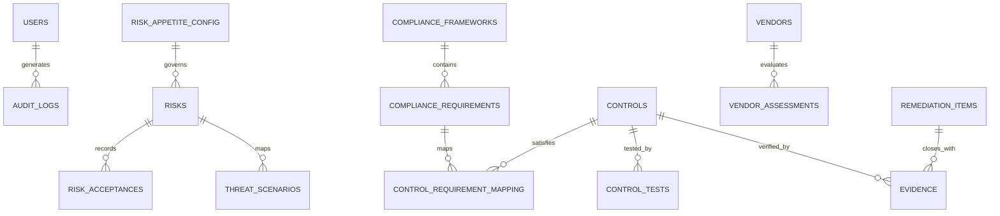

# RiskLens v2.0 — Database Schema Reference

> **Target Database:** PostgreSQL 15+ (Production) / SQLite 3 (Local Development & CI)  
> **ORM:** SQLAlchemy 2.0  
> **Migration Manager:** Alembic  
> **Synthetic Context:** Apex Financial Services  

---

## 1. Entity Relationship Diagram (ERD)

---

## 2. Table Specifications

### 2.1 `users`
System user accounts with enterprise Role-Based Access Control (RBAC).

| Column | Type | Constraints | Description |
|---|---|---|---|
| `id` | INTEGER | PRIMARY KEY, AUTOINCREMENT | Internal surrogate ID |
| `username` | VARCHAR(50) | UNIQUE, NOT NULL, INDEX | Login identifier |
| `email` | VARCHAR(120) | UNIQUE, NOT NULL | Corporate email address |
| `hashed_password` | VARCHAR(255) | NOT NULL | Direct bcrypt hashed password |
| `full_name` | VARCHAR(100) | NULLABLE | Display name |
| `role` | VARCHAR(50) | NOT NULL | Administrator, Consultant, Auditor, Executive, Risk Owner |
| `business_unit` | VARCHAR(100) | NULLABLE | Department or BU assignment |
| `is_active` | BOOLEAN | DEFAULT TRUE | Active status |
| `created_at` | DATETIME | DEFAULT UTC_NOW | Timestamp of creation |
| `last_login` | DATETIME | NULLABLE | Last successful authentication |

---

### 2.2 `risk_appetite_config`
Organisation-wide risk appetite thresholds and governance authorities.

| Column | Type | Constraints | Description |
|---|---|---|---|
| `id` | INTEGER | PRIMARY KEY | Singleton configuration record |
| `organisation_name` | VARCHAR(200) | DEFAULT "Apex Financial Services" | Company name |
| `max_acceptable_inherent_risk` | INTEGER | DEFAULT 15 | Inherent escalation limit |
| `max_acceptable_residual_risk` | INTEGER | DEFAULT 9 | Maximum allowable residual score |
| `risk_tolerance_upper` | INTEGER | DEFAULT 12 | Upper tolerance boundary |
| `escalation_threshold` | INTEGER | DEFAULT 20 | Immediate Board escalation score |
| `risk_review_frequency_days` | INTEGER | DEFAULT 90 | Periodic review cadence |
| `appetite_statement` | TEXT | NULLABLE | Formal governance narrative |

---

### 2.3 `risks`
Core risk register containing inherent, residual, and target risk metrics.

| Column | Type | Constraints | Description |
|---|---|---|---|
| `id` | INTEGER | PRIMARY KEY, AUTOINCREMENT | Internal primary key |
| `risk_id` | VARCHAR(20) | UNIQUE, NOT NULL, INDEX | Risk code (e.g., `RSK-001`) |
| `title` | VARCHAR(200) | NOT NULL | Brief risk statement |
| `category` | VARCHAR(100) | NOT NULL | Cloud, Application, Infrastructure, Identity, etc. |
| `business_unit` | VARCHAR(100) | NOT NULL | Owning division (Retail Banking, Treasury, etc.) |
| `affected_asset` | VARCHAR(200) | NOT NULL | Critical asset name |
| `asset_criticality` | VARCHAR(50) | DEFAULT "High" | Tier 1, High, Medium, Low |
| `threat` | TEXT | NOT NULL | Threat description |
| `threat_actor` | VARCHAR(100) | NULLABLE | Actor category / name |
| `vulnerability` | TEXT | NOT NULL | Underlying weakness |
| `financial_impact` | VARCHAR(50) | NULLABLE | Categorical financial exposure |
| `operational_impact` | VARCHAR(50) | NULLABLE | Downtime / service disruption |
| `reputational_impact` | VARCHAR(50) | NULLABLE | Brand damage |
| `regulatory_impact` | VARCHAR(50) | NULLABLE | Fines / regulatory enforcement |
| `likelihood` | INTEGER | CHECK (1..5), NOT NULL | Probability of occurrence |
| `impact` | INTEGER | CHECK (1..5), NOT NULL | Business impact rating |
| `inherent_risk_score` | FLOAT | NOT NULL | $L \times I$ ($1\text{--}25$) |
| `existing_controls` | TEXT | NULLABLE | Summary of in-place safeguards |
| `control_effectiveness_pct` | FLOAT | CHECK (0..100) | Aggregate control effectiveness |
| `residual_risk_score` | FLOAT | NOT NULL | Calculated with minimum $1.0$ floor |
| `target_risk_score` | FLOAT | NULLABLE | Desired future risk score |
| `risk_trend` | VARCHAR(20) | DEFAULT "Stable" | Improving, Stable, Deteriorating |
| `risk_owner` | VARCHAR(100) | NOT NULL | Named accountable officer |
| `treatment_strategy` | VARCHAR(50) | DEFAULT "Mitigate" | Mitigate, Accept, Transfer, Avoid |
| `status` | VARCHAR(50) | DEFAULT "Open" | Open, Under Review, Remediated, Accepted |

---

### 2.4 `controls`
Cybersecurity control catalog with separate design and operating effectiveness.

| Column | Type | Description |
|---|---|---|
| `control_id` | VARCHAR(20) | Control identifier (e.g., `CTL-001`) |
| `control_name` | VARCHAR(200) | Short descriptive title |
| `framework_reference` | VARCHAR(200) | Mapped standard (NIST CSF 2.0 / ISO 27001) |
| `control_domain` | VARCHAR(100) | Access Control, Cryptography, Incident Response |
| `control_owner` | VARCHAR(100) | Responsible custodian |
| `implementation_status`| VARCHAR(50) | Implemented, Partially Implemented, Planned |
| `design_effectiveness` | VARCHAR(50) | Effective, Partially Effective, Ineffective |
| `operating_effectiveness`| VARCHAR(50)| Effective, Exceptions Noted, Ineffective, Not Tested |
| `effectiveness` | VARCHAR(50) | Legacy combined effectiveness rating |

---

### 2.5 `audit_logs`
Append-only, tamper-evident audit record of platform events.

| Column | Type | Description |
|---|---|---|
| `id` | INTEGER | Sequential event counter |
| `username` | VARCHAR(50) | Initiating user |
| `user_role` | VARCHAR(50) | Active role during execution |
| `action` | VARCHAR(50) | CREATE, UPDATE, DELETE, ACCEPT_RISK, LOGIN, VERIFY |
| `entity_type` | VARCHAR(50) | Risk, Control, Evidence, User, RemediationItem |
| `entity_id` | VARCHAR(50) | ID of modified resource |
| `before_values` | JSON | Serialized pre-change state |
| `after_values` | JSON | Serialized post-change state |
| `change_summary` | TEXT | Human-readable explanation of change |
| `ip_address` | VARCHAR(45) | Client IP address |
| `timestamp` | DATETIME | ISO 8601 UTC timestamp |
