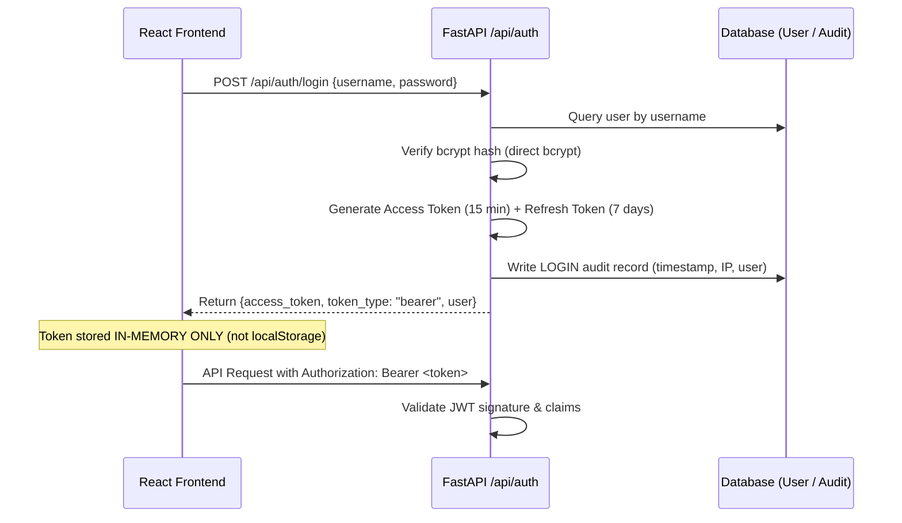

# RiskLens v2.0 — Security Design & Threat Model

> **Status:** APPROVED  
> **Security Baseline:** OWASP ASVS Level 2  
> **Classification:** Enterprise Security Architecture  

---

## 1. Authentication Architecture

### 1.1 In-Memory Token Storage (XSS Defense)
- **Problem:** Storing JWT tokens in `localStorage` or `sessionStorage` exposes sensitive sessions to Cross-Site Scripting (XSS) extraction.
- **Solution:** RiskLens stores the active JWT token strictly in an internal JavaScript closure (`client.ts: let _accessToken = null`). No token is ever serialized into `localStorage` or browser storage.
- **Refresh Flow:** When tokens expire, the client requests a refresh via `POST /api/auth/refresh`.

---

## 2. Role-Based Access Control (RBAC) Matrix

| Endpoint Group | Administrator | Consultant | Risk Owner | Control Owner | Auditor | Executive |
|---|:---:|:---:|:---:|:---:|:---:|:---:|
| **Read Dashboard & Reports** | ✅ | ✅ | ✅ | ✅ | ✅ | ✅ |
| **View Risks & Controls** | ✅ | ✅ | ✅ | ✅ | ✅ | ✅ |
| **Create / Edit Risks** | ✅ | ✅ | ❌ | ❌ | ❌ | ❌ |
| **Accept Risk** | ✅ | ❌ | ✅ | ❌ | ❌ | ❌ |
| **Update Controls & Tests** | ✅ | ✅ | ❌ | ✅ | ❌ | ❌ |
| **Upload Evidence** | ✅ | ✅ | ❌ | ✅ | ❌ | ❌ |
| **View Audit Logs** | ✅ | ❌ | ❌ | ❌ | ✅ | ❌ |
| **Manage Users & Appetite**| ✅ | ❌ | ❌ | ❌ | ❌ | ❌ |
| **Reseed Demo DB** | ✅ | ❌ | ❌ | ❌ | ❌ | ❌ |

---

## 3. Cryptography & Hashing Standards

1. **Password Hashing:**
   - Evaluated via `bcrypt.hashpw` with standard salt rounds.
   - Fixed historical passlib Python 3.13 deprecation by using native `bcrypt` module.
2. **JWT Signing:**
   - Algorithm: `HS256`.
   - Secret key: Loaded via environment variable `JWT_SECRET_KEY` (defaults to random development secret with production override warning).
   - Expiration: Access Token $15$ minutes; Refresh Token $7$ days.

---

## 4. Tamper-Evident Audit Logging

- **Append-Only Architecture:** The `audit_logs` table has no `DELETE` or `UPDATE` routes in the API.
- **State Capture:** Modifications record both `before_values` and `after_values` JSON snapshots to establish provenance.
- **Network Metadata:** Client IP addresses (`request.client.host`) are captured on all mutations.
